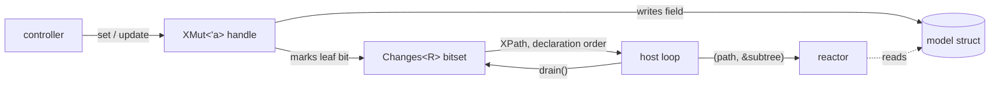
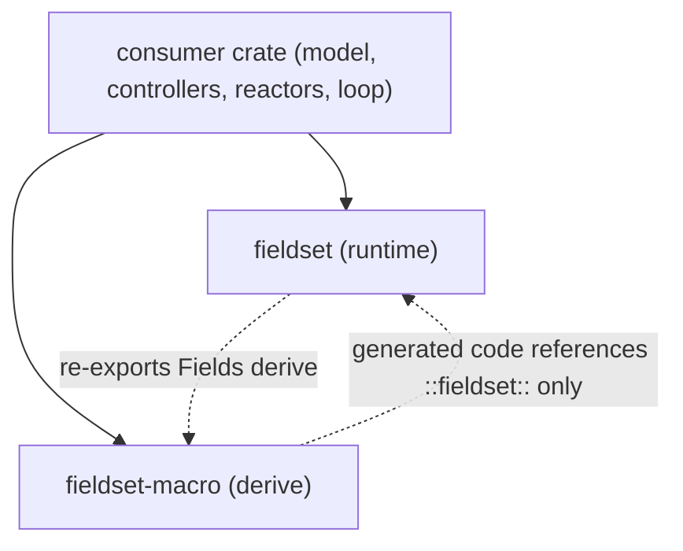
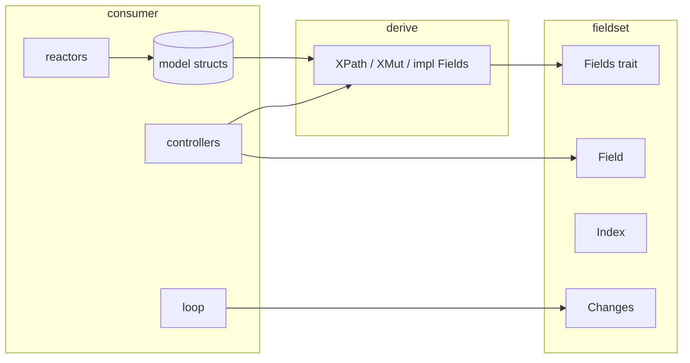

# Architecture Spine — fieldset 0.2

## Design Paradigm

**Plain-data model, lens-style generated handles, dirty-mask notifications.**

- The user's struct is the model and stays pure data. The crate never puts anything inside it.
- A derive generates, beside the model, a *handle* type per struct (a lens: a mutable borrow of one subtree that records which leaves it writes) and a *path* enum per struct (a field reference as data).
- A `Changes<R>` bitset beside the model records which leaves were written. Writers go through handles; readers receive paths and the model.
- The host loop owns sequencing and routing. The crate owns only "every write is recorded".

| Layer | Lives in | Contains |
| --- | --- | --- |
| Derive | `fieldset-macro` | `#[derive(Fields)]`: generates `XPath`, `XMut<'a>`, `impl Fields for X` |
| Runtime | `fieldset` | `Fields`, `Changes<R>`, `Field<'a, T>`, `Index<N>`, bitset |
| Host | consumer crate | model structs, controllers (write through handles), reactors (read paths + model), the loop that drains |



## Invariants & Rules



Dependency direction: consumer → runtime and consumer → derive. The runtime never depends on consumer types except through the `Fields` trait. Generated code names runtime items by absolute path only.

### AD-1 — The model is plain data; the crate adds items beside it, never inside it `[ADOPTED]`

- **Binds:** all
- **Prevents:** tracking state embedded in structs that are `repr(C)`, serialized, or shared over IPC; layout or serde format changes caused by the derive
- **Rule:** `#[derive(Fields)]` adds no fields, no wrappers and no trait bounds to the annotated struct. Everything it generates is a separate item. `Changes<R>` is a separate value the consumer stores wherever it likes.

### AD-2 — Writes go only through generated handles

- **Binds:** F1, F3, F5, F6
- **Prevents:** writes that bypass tracking; two writers of one subtree at the same time
- **Rule:** The only tracked write path is `changes.track(&mut model) -> XMut<'_>` and the methods on the handles it yields. A handle holds `&'a mut Subtree`, `&'a mut Changes<R>` and its base leaf index. Exclusivity is enforced by `&mut`; the crate adds no interior mutability. Direct field assignment on the model is allowed but is not tracked; a consumer that does it must follow with `mark_all()` or accept the missed notification.

### AD-3 — Handle API is methods at every level

- **Binds:** F1, F3, F6
- **Prevents:** eager construction of a handle tree (4.8 KB for a 401-leaf model); a `Cell`-based mask; two read syntaxes; macros or path types in user code
- **Rule:** On `XMut<'a>`: one method per non-skipped field, named exactly as the field. A nested field's method returns the child's `YMut<'_>`. A leaf field's method returns `::fieldset::Field<'_, T>`. `model(&self) -> &X` reads the subtree. Nothing else is generated on the handle: no `Deref`, no public fields, no bulk methods. On `Field<'a, T>`: `get() -> T`, `set(T)`, `set_if_changed(T) where T: PartialEq`, `update(impl FnOnce(&mut T))`. `set` and `update` always mark; `set_if_changed` marks only when the value differs.

### AD-4 — `Changes<R>` is a bitset and nothing more

- **Binds:** F2, F4, F6, F7, F8
- **Prevents:** per-batch allocation or copying; dependence on modification order; overflow policies; capacity parameters in every `static`
- **Rule:** `Changes<R: Fields>` holds exactly `R::COUNT` bits. `const fn new()`. `set` on any handle cannot fail. `drain(&mut self)` and `iter(&self)` yield `R::Path` in ascending leaf order, which is declaration order; `drain` clears as it goes. `mark_all()` sets every bit; `clear()` clears every bit; `len()` and `is_empty()` are popcounts. Memory is `COUNT.div_ceil(32) * 4` bytes. No list, no ordering beyond declaration order, no values.

### AD-5 — Notifications are paths, not values

- **Binds:** F2, F4, F5
- **Prevents:** event size set by the largest field; events that are only valid under an active enum variant; a second copy of any value
- **Rule:** The derive generates `XPath` per struct: `#[repr(u8)]`, `Copy + Clone + Eq + PartialEq + Debug`, one unit variant per leaf, one tuple variant `Sub(SubPath)` per nested field, one `F(Index<N>, TPath)` or `F(Index<N>)` per indexed field. `XPath::leaf(self) -> u16` and `XPath::from_leaf(u16) -> Option<XPath>` are generated, backed by a `const` table in the derive output. For each nested field a projection `fn sub(self) -> Option<SubPath>` is generated. Valued events do not exist in 0.2; a reactor reads the model.

### AD-6 — Routing and policy belong to the host loop

- **Binds:** F2, F7
- **Prevents:** per-write policy hooks in the crate; origin fields on events; reactors mutating the model during a drain
- **Rule:** The crate has no gate, origin, or callback type. The host loop drains after each controller call and decides which reactors see which batch. Reactors receive `(XPath, &Subtree)`; they never receive a handle or `&mut`. A reaction that needs to write does so in a later batch through a handle.

### AD-7 — `Fields` is the composition seam across structs and modules

- **Binds:** all generated code
- **Prevents:** cross-module nesting failures; module-level generated constants; trait-not-in-scope errors; private generated types
- **Rule:** `trait Fields { const COUNT: usize; type Path; type Mut<'a> where Self: 'a; }`. A nested field contributes `<Sub as ::fieldset::Fields>::COUNT` leaves; leaf indices are prefix sums computed in generated `const` expressions, never module-level `const` items. Generated code refers to runtime items as `::fieldset::...` and calls trait methods fully qualified. Every generated item inherits the visibility of the annotated struct.

### AD-8 — Arrays are indexed fields

- **Binds:** F5
- **Prevents:** whole-array events; a table entry per array element; unchecked indices
- **Rule:** `#[fields(indexed)]` on a field of type `[T; N]` generates handle method `f(&mut self, i: ::fieldset::Index<N>)` returning `TMut<'_>` when `T: Fields`, else `Field<'_, T>`. Leaf index is `base + i * T::COUNT + inner` (with `T::COUNT = 1` for a leaf element). `Index<N>` is a bounded newtype constructible only in range. `from_leaf` decodes the element by division.

### AD-9 — Enums with payloads are leaves

- **Binds:** F1, F2
- **Prevents:** events that are only applicable under a specific active variant
- **Rule:** Any enum-typed field, including `Option<T>`, is a leaf: whole-value `get`/`set`. The derive does not descend into variants. The documented model shape for "effect type plus per-type parameters" is the flatten idiom: a tag field plus one sibling struct per payload.

### AD-10 — Leaf types are `Copy`; `PartialEq` only where it is used

- **Binds:** F1, F7
- **Prevents:** drop bookkeeping in the mask design; an undeclared `PartialEq` requirement on every model type
- **Rule:** Every non-skipped leaf type must be `Copy`. `set_if_changed` is the only method bounded by `PartialEq`; `set`, `get`, `update` have no bound beyond `Copy`. A struct with a non-`PartialEq` leaf still derives and still gets `set`.

### AD-11 — Stable Rust, `no_std`, no feature gates, never panic in the derive

- **Binds:** all
- **Prevents:** a nightly requirement; opaque generated types; proc-macro panics as the user's error message
- **Rule:** Both crates build on stable at the declared MSRV. The runtime is `#![no_std]` with no `alloc`. Every generated type is nameable. The derive accepts structs with named fields only and reports every other input, every unsupported type and every generated-name collision with the user's fields as a `syn::Error` carrying the offending span.

### AD-12 — Derive surface

- **Binds:** F1 through F8
- **Prevents:** attribute sprawl; a second derive name; silent shadowing
- **Rule:** One derive, `#[derive(Fields)]`, re-exported from `fieldset`. Field attributes, all under one namespace: `#[fields(nested)]`, `#[fields(skip)]`, `#[fields(indexed)]`. No container attributes in 0.2. Generated items per struct `X`: `XPath`, `XMut<'a>`, `impl Fields for X`, nothing else public.

### AD-13 — 0.2 is a clean break, versioned and published as a pair

- **Binds:** project layout, release
- **Prevents:** two lockfiles; tests running against the published macro; a half-migrated 0.1 surface
- **Rule:** `OptFieldSet`, `BitFieldSet`, `PerfFieldSet`, `IntoIterator for X`, `*_VARIANCE` constants, `FieldSetter` and the closure-based setters are removed, not deprecated. Both crates are `0.2.0`. The repository is one Cargo workspace with one `Cargo.lock`; `fieldset` depends on `fieldset-macro` by `path` and `version`. The macro crate is published first.

### AD-14 — The tests are the contract

- **Binds:** all
- **Prevents:** regressions nobody measures; a derive that only compiles in its own test module
- **Rule:** The test suite must contain, and CI must run: trybuild compile-fail cases for a tuple struct, a generic struct, a path-typed nested field and a name collision, each asserting the message; a cross-module nested derive; a `use fieldset::Fields;`-only derive; a property test driving `Changes` and handles against a reference model (a set of leaf indices) for arbitrary write sequences; size and `COUNT` assertions on a 400-leaf replica; and a benchmark under `benches/` measuring set-then-drain per changed field.

### AD-15 — CI runs the contributor's checks on stable and on the MSRV

- **Binds:** project layout
- **Prevents:** a CI that builds but checks nothing
- **Rule:** CI runs `cargo fmt --check`, `cargo clippy --all-targets -D warnings`, `cargo test --workspace` and `cargo doc --no-deps` on stable and on the declared `rust-version`. The nix flake remains the dev shell and may run in CI too, but is not the only job.

## Consistency Conventions

| Concern | Convention |
| --- | --- |
| Generated type names | `XPath`, `XMut<'a>` from struct `X`; no other suffixes |
| Generated method names | exactly the field name; `model`, `get`, `set`, `set_if_changed`, `update` are reserved and collide with a compile error |
| Runtime names | `Fields`, `Changes<R>`, `Field<'a, T>`, `Index<N>`; `changes.track(&mut model)`, `drain`, `iter`, `mark_all`, `clear`, `len`, `is_empty` |
| Leaf index | `u16`, ascending in declaration order, nested subtrees contiguous, arrays contiguous per element |
| Path enum | `#[repr(u8)]`, derives `Copy, Clone, Eq, PartialEq, Debug`; `leaf()`, `from_leaf()`, one `Option` projection per nested field |
| Attribute namespace | `#[fields(...)]` only |
| Error reporting | `syn::Error` with the span of the field or struct; message names the struct and the field |
| Generated code hygiene | `::fieldset::` absolute paths; fully-qualified trait calls; visibility inherited from the struct |
| Unsafe | none in 0.2; a future unsafe block requires an exhaustive test over every leaf |
| Docs | README is `#![doc = include_str!(...)]` of `lib.rs`; every generated item is `#[doc]`-ed with the field it stands for |

## Stack

| Name | Version |
| --- | --- |
| Rust (edition 2021) | stable 1.99.1 at authoring; `rust-version` [ASSUMPTION] 1.80, to be confirmed with `cargo msrv` in the first build |
| `fieldset` runtime dependencies | none |
| `syn` | 3.0.9 [ASSUMPTION] if `DeriveInput`/`Attribute` API unchanged from 2.x; else 2.x |
| `quote` | 1.0.47 |
| `proc-macro2` | 1.0.107 |
| `heck` | 0.5.0 |
| `trybuild` (dev) | 1.0.122 |
| `proptest` (dev) | 1.12.0 |

## Structural Seed

```text
fieldset/                      # workspace root, one Cargo.lock
  Cargo.toml                   # [workspace] members = ["fieldset", "fieldset-macro"]
  fieldset/
    src/lib.rs                 # re-exports; #![no_std]; README as crate doc
    src/fields.rs              # trait Fields
    src/changes.rs             # Changes<R>, Drain, Iter
    src/bitset.rs              # word bitset + ones iterator (cited from artemis stable_partition_index)
    src/field.rs               # Field<'a, T>
    src/index.rs               # Index<N>
    tests/ui/                  # trybuild cases
    tests/cross_module.rs
    tests/model.rs             # proptest against the reference model
    tests/replica.rs           # 400-leaf replica: sizes, COUNT, drain order
    benches/drain.rs
  fieldset-macro/
    src/lib.rs                 # entry, error handling
    src/parse.rs               # attributes, field classification
    src/paths.rs               # XPath, projections, leaf table
    src/handles.rs             # XMut, field methods
    src/fields_impl.rs         # impl Fields, COUNT prefix sums
```



## Capability → Architecture Map

Capabilities are the eight usage flows in the research note.

| Capability / Area | Lives in | Governed by |
| --- | --- | --- |
| F1 controller writes one or several fields with reads through the same handle; narrowed per subtree | `XMut`, `Field` | AD-2, AD-3, AD-10 |
| F2 loop drains per controller and routes batches; reactors get path + model | `Changes::drain`, `XPath` | AD-4, AD-5, AD-6 |
| F3 bulk reset of a sub-struct with one notification per field | consumer writes the struct, then `mark_all` on that subtree's handle | AD-2, AD-4 |
| F4 replay after preset load | `Changes::mark_all` | AD-4 |
| F5 per-element events for arrays | `Index<N>`, indexed handle methods, `F(Index<N>, TPath)` | AD-8, AD-5 |
| F6 small polled roots, cheap clear, no copy on drain | `Changes` bitset | AD-4, AD-3 |
| F7 save-if-anything-changed | `set_if_changed` + `Changes::is_empty` | AD-10, AD-4 |
| F8 long-lived sets in statics | `Changes::new` is `const fn` | AD-4, AD-11 |

## Deferred

- **Non-`Copy` leaves.** Needs drop bookkeeping or a different leaf handle. Revisit when a consumer has a non-`Copy` field it must track.
- **Nested enum editing and `Option<T>` prisms.** Deferred until a consumer cannot use the flatten idiom. Any design must keep AD-5's property that every path is applicable in every model state.
- **Valued events** (`path.read(&model)`, `model.apply(change)`). Deferred until a consumer must transport a change without the model, such as per-event IPC or an undo log.
- **Bounded capacity or a staged variant.** The bitset has no capacity to bound; a staged `Changes` with an arena is a separate type if rollback is ever needed.
- **Sibling handles at once** (`split()` returning a tuple of child handles). Needs a shared mask; add only when two sub-controllers must hold handles simultaneously.
- **Bitset crate extraction.** The ones-iterator is copied from artemis's `stable_partition_index` with a citation; extract to a shared crate at the third consumer.
- **Rename attribute for generated-name collisions.** Open question: ship `#[fields(rename = "...")]` in 0.2 or wait for the first collision report. Until decided, collisions are a compile error.
- **Container attributes** (derive lists, custom path type names). No consumer needs them; the path enum derives only std traits.
- **Consumer migration** (artemis). Separate initiative; this spine's F1–F8 are its acceptance evidence.
